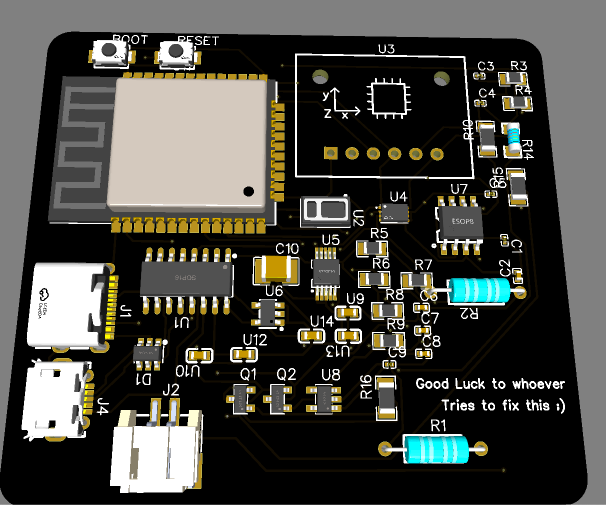
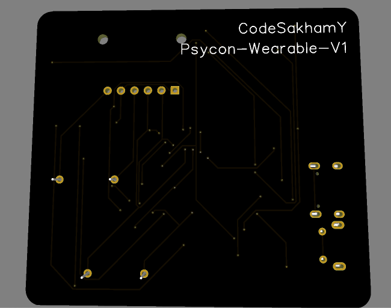
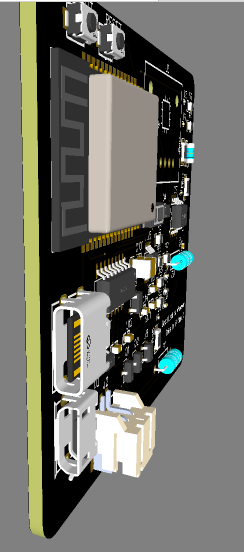
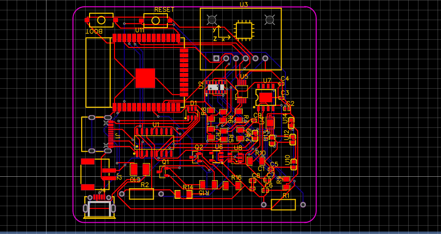
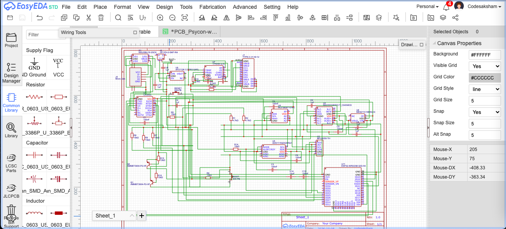

# Half-life-HackClub
# Psycon-wearable-pcb-V1

custom pcb for my psycon wearable project. designed in easyeda.

## THE BOARD

It is an pcb board loaded with various sensors powered with esp32 as its main brain which would basically help me in making my first version of a smart watch like health wearable
## COMPONENTS

- **ESP32-WROOM-32D** — main microcontroller
- **MAX30102** — optical pulse sensor
- **MPU6050** — accelerometer + gyroscope
- **MCP9808** — temperature sensor
- **ADS1115** — 16-bit adc
- **CH340C** — usb-to-serial interface
- **TP4056** — lithium-ion battery charger
- **AP2112K-3.3** — 3.3v voltage regulator
- **ME6211C18** — 1.8v voltage regulator
- **USB-C + micro-usb connectors**
- **JST-PH connector** — battery connection
- resistors, capacitors, switches and usb protection components

## PCB DESIGN

schematic, component placement and routing are done in easyeda.

## IMAGES

### 3d view

### pcb routing

### schematic

designing is done. next step is getting the board manufactured, recieving it , adding the code and testing it and seeing if everything works!!

The entire pcb was designed in easyeda but duet to the repo submision checks error i have added the .kicad_pcb file but please refer to only the files in the folder named psycon-wearable.
